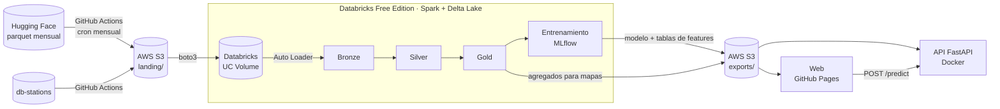

# ¿Llegará tarde mi tren? — Predicción de retrasos de Deutsche Bahn

Pipeline de Big Data con arquitectura **Medallion** (Bronze → Silver → Gold) sobre **más de 200 millones de registros** de paradas de trenes en Alemania. El pipeline entrena un modelo de clasificación que estima la probabilidad de que un tren llegue con más de 5 minutos de retraso. El modelo se publica como **API REST** (FastAPI + Docker) y se consulta desde una **página web** con mapas de puntualidad.

**Web:** [https://samuelsanchez03.github.io/deutschebahn-delay-predictor/](https://samuelsanchez03.github.io/deutschebahn-delay-predictor/) · **API en vivo:** [https://db-delay-api-rrbh.onrender.com/docs](https://db-delay-api-rrbh.onrender.com/docs) (Swagger) · **Colección de Postman:** [`docs/postman/`](docs/postman/db-delay-api.postman_collection.json)

> **Proyecto en construcción.** La sección [Estado del proyecto](#estado-del-proyecto) indica qué partes ya funcionan.

---

## Contenido

1. [Problema y objetivo](#problema-y-objetivo)
2. [Datos](#datos)
3. [Arquitectura](#arquitectura)
4. [Pipeline Medallion](#pipeline-medallion)
5. [Modelo](#modelo)
6. [API del modelo](#api-del-modelo)
7. [Aplicación web](#aplicación-web)
8. [Estructura del repositorio](#estructura-del-repositorio)
9. [Cómo reproducir el proyecto](#cómo-reproducir-el-proyecto)
10. [Costos](#costos)
11. [Decisiones de diseño](#decisiones-de-diseño)
12. [Estado del proyecto](#estado-del-proyecto)
13. [Atribución y licencias](#atribución-y-licencias)

---

## Problema y objetivo

**Pregunta:** *dado el tipo de tren, la estación, la línea, el día y la hora, ¿qué tan probable es que el tren llegue con retraso?*

- **Tipo de tarea:** clasificación binaria.
- **Etiqueta:** `label = 1` si `delay_in_min > 5`. Deutsche Bahn considera puntual un tren con menos de 6 minutos de retraso.
- **Uso:** una persona elige estación, línea, día y hora en la web; la web consulta la API y muestra la probabilidad de retraso.

## Datos

| Fuente | Contenido | Licencia |
|---|---|---|
| [`piebro/deutsche-bahn-data`](https://huggingface.co/datasets/piebro/deutsche-bahn-data) (Hugging Face) | Un parquet por mes con cada parada de tren: horarios planeados, retraso, cancelaciones, tipo y línea | CC BY 4.0 |
| [`db-stations`](https://github.com/derhuerst/db-stations) (npm) | Coordenadas de las estaciones por número EVA | CC BY 4.0 |

**Volumen** (medido con `ingest/measure_dataset.py` el 2026-11-14):

| Periodo | Archivos | Tamaño | Filas | Cobertura |
|---|---|---|---|---|
| 2024-07 → 2025-10 | 16 | 0.97 GB | 31.7 M (≈2 M/mes) | ~100 estaciones principales |
| 2025-11 → 2026-10 | 12 | 4.32 GB | 178.6 M (≈15 M/mes) | Todas las estaciones |
| **Total** | **28** | **5.29 GB** | **210.3 M** | |

En noviembre de 2025 el autor del dataset amplió la cobertura a todas las estaciones. Por eso el proyecto trabaja con las **~100 estaciones core**, que son las únicas con historia completa desde 2024-07.

## Arquitectura



| Componente | Herramienta | Función |
|---|---|---|
| Ingesta programada | GitHub Actions | Descarga mensual de Hugging Face y npm a S3 |
| Data lake | AWS S3 | `landing/` (datos crudos) y `exports/` (modelo y agregados) |
| Procesamiento | Databricks Free Edition (PySpark, Delta Lake, Unity Catalog, Auto Loader) | Capas Bronze, Silver y Gold |
| Orquestación | Databricks Jobs + GitHub Actions | Pipeline mensual de punta a punta |
| Experimentos | MLflow | Registro de corridas, métricas y modelo |
| Publicación del modelo | FastAPI + Docker | API REST documentada con OpenAPI |
| Visualización | HTML + Leaflet + ECharts en GitHub Pages | Mapas, tendencias y buscador de predicciones |

## Pipeline Medallion

Esquemas `bronze`, `silver` y `gold` en Unity Catalog (catálogo `workspace`).

### Puente S3 → Volume
Databricks Free Edition no permite registrar buckets externos, así que un notebook copia los archivos de S3 a un Volume de Unity Catalog. En ese paso se corrige el tipo de las columnas de tiempo (nanosegundos → microsegundos), porque Spark no puede leer el formato original.

### Bronze — los datos tal como llegaron
- `bronze.train_stops`: Auto Loader lee los parquet del Volume de forma incremental (solo archivos nuevos o modificados). No se limpia ni se filtra nada; se agregan columnas de linaje (`_source_file`, `_file_modified_at`, `_ingested_at`).
- `bronze.stations`: coordenadas de `db-stations`, se reescribe completa en cada corrida.

| Tabla | Filas | Notas |
|---|---|---|
| `bronze.train_stops` | **210,288,625** | 28 meses (2024-07 → 2026-10); coincide exactamente con la fuente |
| `bronze.stations` | 5,388 | Incluye EVAs alternativos y estado federal |

Las columnas de tiempo quedan como `timestamp_ntz` (sin zona horaria): ya están en hora local alemana, así que `hour()` y `dayofweek()` dan la hora y el día correctos sin conversiones.

### Silver — datos limpios y confiables
Antes de limpiar, `04_bronze_profile` midió cada problema sobre las 210 M filas de Bronze. Cada regla de Silver responde a un hallazgo medido:

| Hallazgo en Bronze | Tratamiento en Silver | Justificación |
|---|---|---|
| **Duplicados:** 0 `id` repetidos | Deduplicar por `id` conservando la versión ingerida más reciente | Si el autor reprocesa un mes, Bronze recibe las filas otra vez |
| **Nulos:** 1.49 M filas (0.7%) sin tipo de tren, sin retraso y sin hora planeada (son las mismas filas) | Se descartan | No se puede saber qué tren era ni cuándo pasaba |
| **Nulos esperados:** llegada o salida planeada nula (~10.5% cada una) | `planned_time = coalesce(llegada, salida)` | La primera parada no tiene llegada y la última no tiene salida |
| **Outliers:** retrasos de −1,446 a 2,795 min (p50 = 1, p99 = 35, p99.9 = 86) | Bandera `dq_delay_outlier` si > 300 o < −30 min (~8.8 mil filas) | Se marcan en vez de borrarse para poder auditarlos; se excluyen del modelo. Los retrasos de −30 a 0 (trenes que llegan antes) se conservan |
| **Cancelaciones:** 8.5 M paradas (4%), casi todas con `delay_in_min` | Bandera `is_canceled`; se excluyen del label y se cuentan aparte | El retraso de una parada cancelada no tiene significado |
| **Llaves inconsistentes:** EVA `08000001` en el dataset vs `8000001` en db-stations (match **0 de 146**) | `CAST(eva AS BIGINT)` en ambos lados | Sin normalizar, ninguna estación tendría coordenadas |
| **Categorías sucias:** 302 valores de `train_type`, muchos escritos a mano (`SEV`, `Bvs`, `bUS`…) | `train_category` = Bus / Larga distancia / S-Bahn / Regional, por reglas con prioridad | Agrupa operadores regionales y variantes de bus de reemplazo; los buses se excluyen del modelo |
| **Tipos:** horas como `timestamp_ntz` (hora alemana, sin zona) | `hour`, `dow`, `month` y `service_date` se derivan directamente | No hace falta convertir zona horaria |

Silver conserva **todas las estaciones** con la bandera `is_core_station`, que marca las **146 estaciones** presentes antes de 2025-11 (~55 M filas). El mapa de tramos necesita estaciones consecutivas; el modelo filtra a las core en Gold. La tabla usa *liquid clustering* por `(service_date, eva)`.

**Resultados:**

| Paso | Filas |
|---|---|
| Bronze | 210,288,625 |
| − duplicados por `id` | 0 |
| − sin tipo de tren ni hora planeada | 1,491,887 |
| **= `silver.train_stops`** | **208,796,738** (5,459 estaciones) |
| de ellas, estaciones core | 54,759,917 (146 estaciones) |

| Métrica de calidad | Valor |
|---|---|
| Paradas canceladas | 8,488,020 (4.1%) |
| Outliers de retraso marcados | 9,674 (0.005%) |
| Paradas con retraso > 5 min (sin canceladas ni outliers) | ≈ 16% → clases desbalanceadas |
| Match de coordenadas, estaciones core | 137 de 146 estaciones, **99.9% de las filas** |
| Match de coordenadas, resto | 5,281 de 5,313 estaciones, 99.6% de las filas |

| Categoría | Todas | Core |
|---|---|---|
| Regional | 98.3 M | 24.8 M |
| S-Bahn | 98.1 M | 22.6 M |
| Larga distancia | 6.8 M | 6.0 M |
| Bus (excluido del modelo) | 5.6 M | 1.4 M |

Las 9 estaciones core sin coordenadas tienen muy poco volumen: varias no tienen nombre o tienen EVAs fuera del rango alemán. En `gold.data_quality_monthly` todos los meses tienen datos en todas sus horas; marzo tiene 743 horas por el cambio de horario de verano. Aparecen además unas pocas filas en 2024-06 y 2026-11: son trenes de la última noche del mes con hora planeada en el mes contiguo.

Tablas adicionales:
- `silver.dim_station`: EVA → nombre oficial, coordenadas, estado federal. Incluye los EVAs alternativos (`additionalIds`).
- `gold.data_quality_monthly`: filas, filas core, estaciones, cancelaciones, nulos, outliers, horas con datos y % de retraso por mes.

### Gold — tablas listas para consumir
Base común: **paradas válidas** de Silver (no canceladas, sin outlier, sin buses). **Label:** `delay_in_min > 5`.

| Tabla | Grano | Filas | Uso |
|---|---|---|---|
| `gold.station_daily` | estación × día | 1,927,249 | Mapa de puntualidad y tendencias (% puntual, retraso promedio, p90, % cancelado) |
| `gold.route_daily` | línea × día | 1,160,663 | Tasas históricas por línea |
| `gold.segments` | par de estaciones consecutivas | 2,569 | Mapa de tramos: `delay_gain` = retraso en la parada − retraso en la anterior. Datos desde 2025-11, ≥ 200 viajes por tramo |
| `gold.model_stations` | estación | 131 | Estaciones core con coordenadas y activas en los últimos 3 meses |
| `gold.holidays` | estado × fecha | 697 | Festivos nacionales y estatales (librería `holidays`) |
| `gold.features` | parada | **50,127,006** | Tabla de entrenamiento sin *leakage* |
| `gold.data_quality_monthly` | mes | 29 | Métricas de calidad (ver Silver) |

En `gold.features` la tasa de retraso es **19.0%**: Regional 20.1%, S-Bahn 11.4% y **Larga distancia 44.3%**. Los trenes de larga distancia recorren cientos de kilómetros y van acumulando retraso.

## Modelo

- **Features:** estación, estado federal, categoría y tipo de tren (los tipos con menos de 50 mil paradas se agrupan en `OTHER`), hora, día de la semana, mes, fin de semana, festivo **del estado de la estación**, posición en la ruta, y cinco tasas históricas de retraso: estación (7 y 28 días), estación a esa hora (28 días) y línea (7 y 28 días).
- **Sin leakage:** cada feature se conoce *antes* de que llegue el tren. Las tasas históricas se calculan con ventanas `rangeBetween(-N, -1)` que **terminan el día anterior**, y se suavizan hacia la tasa global (`(retrasos + 20·global) / (paradas + 20)`) para que las líneas con pocas observaciones no den tasas extremas. El notebook lo verifica: en el primer día de cada estación, sin historia, la tasa es exactamente la global.
- **Señal de las features:** correlación con el label de 0.25 a 0.30. La más fuerte es la tasa de la línea en 28 días (0.298).
- **Codificación:** las variables categóricas (estación, tipo de tren) se indexan; la línea entra por sus tasas históricas porque tiene miles de valores distintos. Los modelos de árboles no requieren normalizar; la regresión logística sí se estandariza.
- **Split temporal** (nunca aleatorio, para no "filtrar el futuro"):

  | Conjunto | Periodo | Filas | % positivos |
  |---|---|---|---|
  | Entrenamiento | 2024-08 → 2026-08 | 44,648,435 | 19.0% |
  | Validación (hiperparámetros y umbral) | 2026-09 | 1,825,134 | 21.0% |
  | Prueba (se evalúa una sola vez) | 2026-10 | 1,868,679 | 20.3% |

  Julio de 2024 se descarta porque las tasas de 28 días todavía no tienen historia completa.
- **Modelos:**
  - *Baseline:* la tasa de retraso de la línea en 28 días, usada directo como probabilidad.
  - *Regresión logística en Spark ML:* entrenada de forma distribuida sobre 11 M filas. Las categóricas (incluidas hora y día) van con *one-hot* y las numéricas se estandarizan.
  - ***LightGBM*** (modelo publicado): entrenado sobre una muestra de 4 M filas, con *early stopping* en validación y un grid de 2 configuraciones. Las categóricas se codifican con un vocabulario que se guarda junto al modelo para que la API use la misma codificación.
- **Métrica principal: AUC-PR.** Las clases están desbalanceadas (la mayoría de los trenes llegan a tiempo), y AUC-PR mide qué tan bien se detecta la clase minoritaria sin dejarse inflar por los verdaderos negativos. También se reporta **F1** al umbral elegido, AUC-ROC y una curva de calibración, porque la web muestra probabilidades.

### Resultados (conjunto de prueba, octubre 2026)

| Modelo | AUC-PR | AUC-ROC | F1 | Precisión | Recall |
|---|---|---|---|---|---|
| Aleatorio (referencia) | 0.203 | 0.500 | — | — | — |
| Baseline: tasa de la línea (28 días) | 0.407 | 0.705 | 0.432 | 0.350 | 0.563 |
| Regresión logística (Spark ML) | 0.484 | 0.777 | 0.494 | 0.425 | 0.590 |
| **LightGBM** | **0.537** | **0.802** | **0.525** | **0.462** | **0.607** |

LightGBM mejora el AUC-PR en **32%** sobre el baseline. El umbral de clasificación (0.28) se eligió en validación maximizando F1. Es menor a 0.5 porque la clase positiva es minoritaria.

**Calibración.** Las probabilidades del modelo coinciden con la frecuencia real, lo cual importa porque la web las muestra tal cual:

| Probabilidad predicha | 5% | 15% | 25% | 35% | 45% | 55% | 65% | 75% | 84% |
|---|---|---|---|---|---|---|---|---|---|
| Tasa real de retraso | 5% | 15% | 24% | 33% | 43% | 54% | 65% | 76% | 87% |

**Importancia de variables** (*gain*): la tasa de retraso de la estación a esa hora en los últimos 28 días (23%), la posición en la ruta (16%; el retraso se acumula a lo largo del recorrido), la estación (13%) y la tasa de la línea en 28 días (12%).

**Por categoría:** el modelo es más preciso en larga distancia (AUC-PR 0.734, con 48% de retrasos) que en regional (0.481) y S-Bahn (0.365, con 12% de retrasos más aleatorios).

Todas las corridas quedan en MLflow (experimento `db-delay-experiment`). El modelo está registrado en Unity Catalog como `workspace.ml.delay_classifier` (versión 1) y sus artefactos (`model.txt`, `model_meta.json`, calibración e importancia) se guardan en el Volume `ml.artifacts`.

## API del modelo

Servicio **FastAPI** empaquetado en **Docker** (`api/`) y desplegado en Render: **https://db-delay-api-rrbh.onrender.com** (documentación en [`/docs`](https://db-delay-api-rrbh.onrender.com/docs)). Carga el modelo LightGBM (`model.txt.gz`), sus metadatos y las tablas de consulta (`lookups.json`) que genera `08_export`. Con eso **reconstruye las mismas features que en el entrenamiento** a partir de una consulta simple: mismo orden, mismo vocabulario y misma convención de día de la semana que Spark.

| Endpoint | Método | Descripción |
|---|---|---|
| `/health` | GET | Estado, versión del modelo y fecha de los datos |
| `/stations` | GET | Las 131 estaciones del modelo |
| `/stations/{eva}/routes` | GET | Líneas que pasaron por la estación en las últimas 4 semanas, con sus horarios |
| `/predict` | POST | Probabilidad de retraso > 5 min para una estación, línea, fecha y hora |
| `/predict/hourly` | POST | Probabilidad para cada hora en que pasa la línea (para graficar) |
| `/docs` · `/openapi.json` | GET | Documentación interactiva (Swagger) y especificación OpenAPI |

**Ejemplo de respuesta** de `POST /predict`:
```json
{"eva": "8000105", "station": "Frankfurt (Main) Hbf", "route_key": "S7", "train_type": "S",
 "date": "2026-11-20", "hour": 8, "probability": 0.1494, "delayed": false, "threshold": 0.2822,
 "risk": "bajo", "usual_service": true, "is_holiday": false, "data_as_of": "2026-10-31", "model_version": "1.0.0"}
```

### Consultar la API

**Desde el navegador (Swagger).** Abre `https://db-delay-api-rrbh.onrender.com/docs`, elige un endpoint, presiona *Try it out*, edita el ejemplo y *Execute*. Muestra la petición, el `curl` equivalente y la respuesta.

**Desde Postman.** El repositorio incluye una colección lista: [`docs/postman/db-delay-api.postman_collection.json`](docs/postman/db-delay-api.postman_collection.json).

1. En Postman: *Import* → arrastra el archivo de la colección.
2. Abre la colección → pestaña *Variables* → `baseUrl` ya apunta a `https://db-delay-api-rrbh.onrender.com`; cámbiala a `http://localhost:8000` si corres la API localmente → *Save*.
3. Ejecuta las peticiones en orden:

   | Carpeta | Peticiones | Qué verifica |
   |---|---|---|
   | 1 · Estado y catálogo | Health, Estaciones, Líneas de una estación | Que el servicio responda; guarda la línea más frecuente de la estación en la variable `route_key` |
   | 2 · Predicción | Predecir retraso, Predicción por hora del día | Probabilidad entre 0 y 1, coherente con el umbral |
   | 3 · Validación de entradas | 6 peticiones inválidas | Que cada una responda `422` con el motivo del error |

4. Para correr todo de una vez: clic derecho en la colección → *Run collection* → *Run*. Cada petición trae *tests*, y el resumen muestra cuáles pasaron.

Variables de la colección: `baseUrl`, `eva` (por defecto `8000105`, Frankfurt Hbf), `route_key` y `date`. Para consultar otra estación, cambia `eva` y vuelve a ejecutar *Líneas de una estación*.

*Alternativa sin la colección:* Postman también puede importar la especificación directamente. *Import* → pega `https://db-delay-api-rrbh.onrender.com/openapi.json` → Postman genera una petición por endpoint con sus esquemas.

**Desde la terminal (`curl`):**
```bash
curl https://db-delay-api-rrbh.onrender.com/stations/8000105/routes
curl -X POST https://db-delay-api-rrbh.onrender.com/predict -H "Content-Type: application/json" \
     -d '{"eva": "8000105", "route_key": "S7", "date": "2026-11-20", "hour": 8}'
```

> En el plan gratuito de Render, la primera petición después de 15 minutos sin uso tarda ~30–60 s mientras el servicio arranca. Las siguientes responden en milisegundos.

**Validación de entradas** (Pydantic). Las peticiones inválidas reciben `422` con el campo y el motivo:

| Caso | Respuesta |
|---|---|
| EVA con formato inválido (`"abc"`) | `string_pattern_mismatch` |
| Estación fuera del modelo | `estación desconocida` |
| Línea que no pasa por esa estación | `la línea '…' no pasa por la estación …` |
| Fecha fuera del horizonte (desde el día siguiente a los datos y hasta 180 días después) | `la fecha debe estar entre …` |
| Hora fuera de 0–23 o con tipo incorrecto | `less_than_equal` / `int_parsing` |
| Campo faltante | `missing` |

Los errores no previstos devuelven `500` con un JSON genérico, sin exponer detalles internos. La API también indica si la línea suele pasar a esa hora (`usual_service`) y si la fecha es festivo en el estado de la estación (`is_holiday`).

**Pruebas:** `api/tests/test_api.py` (16 pruebas: respuestas válidas, cada caso de validación, documentación OpenAPI y la convención de día de la semana).

## Aplicación web

Página estática (HTML, CSS y JavaScript sin *build*) publicada en GitHub Pages. Usa [Leaflet](https://leafletjs.com/) para el mapa y [ECharts](https://echarts.apache.org/) para las gráficas. Tiene cuatro vistas:

| Vista | Qué muestra | Fuente |
|---|---|---|
| **Predicción** | Formulario estación → línea → fecha → hora. Devuelve la probabilidad de retraso, el nivel de riesgo, la curva de probabilidad a lo largo del día y la puntualidad reciente de la estación | **API** (`/stations/{eva}/routes`, `/predict`, `/predict/hourly`) |
| **Mapa de puntualidad** | Las 131 estaciones del modelo coloreadas por puntualidad o retraso medio (últimos 30 días), ranking y ficha de cada estación con enlace a la predicción | `data/stations.json` |
| **Tendencias** | Puntualidad mensual por tipo de tren (28 meses) y mapa de calor día × hora de las últimas 12 semanas | `data/trends_monthly.json`, `data/heatmap.json` |
| **Sobre el modelo** | Pipeline, comparación de modelos, hiperparámetros, importancia de variables y curva de calibración | `data/model.json` |

**La predicción siempre se pide a la API**; la web no tiene una copia del modelo. Los archivos de `data/` son agregados que exporta `08_export` y que el workflow de despliegue descarga de S3.

**Manejo de errores** (`web/js/api.js`):

| Situación | Comportamiento |
|---|---|
| La API tarda (servidor dormido en Render) | Tiempo de espera de 90 s en la primera consulta y aviso de "despertando la API" |
| *Timeout*, error de red o `5xx` | Hasta 3 reintentos con espera exponencial (1.5 s, 3 s, 6 s), con aviso en pantalla |
| `422` / `404` | Sin reintento; muestra el mensaje de validación de la API (campo y motivo) |
| Respuesta con forma inesperada | Se valida cada respuesta (por ejemplo, que `probability` esté entre 0 y 1) y se muestra un error en lugar de datos incorrectos |
| Formulario incompleto o fecha fuera de rango | Validación en el navegador antes de llamar a la API |

El estado de la API (`/health`) aparece en la barra lateral. Para probar la web contra una API local: `http://localhost:8000/?api=http://localhost:8001`.

## Estructura del repositorio

```text
db-delay-predictor/
├── README.md
├── environment.yml           # Entorno conda local
├── docs/
│   ├── aws/                  # Políticas IAM de mínimo privilegio
│   ├── postman/              # Colección de Postman para consultar la API
│   └── img/                  # Capturas para el README
├── scripts/                  # Verificación de permisos de AWS y ejecución de notebooks
├── ingest/                   # Hugging Face + db-stations → S3
├── databricks/               # Notebooks del pipeline (Bronze, Silver, Gold, ML)
├── api/                      # FastAPI + Dockerfile + pruebas; model/ guarda el modelo exportado
├── render.yaml               # Despliegue de la API en Render
├── web/                      # Web estática: index.html, css/, js/; data/ se descarga de S3
└── .github/workflows/        # Publicación de la web en GitHub Pages
```

---

## Cómo reproducir el proyecto

### Requisitos
- Cuenta de **AWS** (S3 + IAM)
- Cuenta de **Databricks Free Edition**, verificada con LinkedIn para habilitar la salida a internet
- Cuenta de **GitHub**
- **Conda** (Miniconda o Anaconda), **git** y **Docker**

### 1. Clonar y crear el entorno

```bash
git clone https://github.com/<usuario>/deutschebahn-delay-predictor.git
cd deutschebahn-delay-predictor
conda env create -f environment.yml
conda activate db-delays
```

El entorno trae Python 3.12, las librerías de ingesta y el AWS CLI.

### 2. Configurar AWS

1. **Bucket S3** en `us-east-1`, con *Block all public access* activado. El nombre debe ser único a nivel mundial, por ejemplo `db-delays-<usuario>`.
2. **Dos usuarios IAM**, sin acceso a la consola, cada uno con una política *inline* de mínimo privilegio (reemplaza `NOMBRE_DEL_BUCKET`):

   | Usuario | Política | Permisos |
   |---|---|---|
   | `db-gh-actions` | [`docs/aws/policy-db-gh-actions.json`](docs/aws/policy-db-gh-actions.json) | Escribe en `landing/`, lee `exports/` |
   | `db-databricks` | [`docs/aws/policy-db-databricks.json`](docs/aws/policy-db-databricks.json) | Lee `landing/`, escribe en `exports/` |

   Para cada usuario crea un *access key* de tipo *Application running outside AWS*. **Nunca subas las llaves al repositorio.**
3. **Alerta de costos:** Billing → Budgets → *Monthly cost budget*. Si tu cuenta tiene créditos promocionales, en las opciones avanzadas **excluye los créditos** del cálculo. Si no, el costo neto aparece en $0 y la alerta nunca se dispara.
4. **Perfiles locales:** registra las llaves de cada usuario en un perfil con nombre (región `us-east-1`, formato `json`):
   ```bash
   aws configure --profile db-gh-actions
   aws configure --profile db-databricks
   ```
5. **Verificación de permisos:** el script prueba lo que cada usuario debe poder hacer y también lo que debe fallar:
   ```bash
   scripts/check_aws_access.sh <tu-bucket>
   ```
   Al final deja un archivo de prueba `landing/_check.txt`. Ningún usuario puede borrar en `landing/`, así que elimínalo desde la consola de S3.

### 3. Configurar Databricks

1. Instala el [Databricks CLI](https://docs.databricks.com/aws/en/dev-tools/cli/install) y autentícate:
   ```bash
   databricks auth login --host https://<tu-workspace>.cloud.databricks.com
   ```
2. Crea el *secret scope* `aws` y copia ahí las llaves del perfil local `db-databricks`. Los notebooks las leen con `dbutils.secrets.get(...)`, y Databricks las oculta (`[REDACTED]`) si se imprimen:
   ```bash
   databricks secrets create-scope aws
   databricks secrets put-secret aws bucket --string-value <tu-bucket>
   printf %s "$(aws configure get aws_access_key_id --profile db-databricks)" | databricks secrets put-secret aws access_key_id
   printf %s "$(aws configure get aws_secret_access_key --profile db-databricks)" | databricks secrets put-secret aws secret_access_key
   databricks secrets list-secrets aws      # debe listar las 3 claves (sin mostrar valores)
   ```
   `printf %s` quita el salto de línea final, que de otro modo quedaría guardado como parte de la llave.
3. Crea los esquemas y Volumes, y prueba que Databricks llega a S3. `scripts/run_notebook.py` sube los notebooks de `databricks/` a tu carpeta del workspace, los ejecuta en serverless y muestra su salida:
   ```bash
   python scripts/run_notebook.py 00_setup      # esquemas bronze/silver/gold/ml + volumes
   python scripts/run_notebook.py 01_check_s3   # debe terminar con "Conectividad OK"
   ```
   Si `01_check_s3` falla por red o *timeout*, la cuenta de Free Edition no tiene salida a internet. Verifícala con LinkedIn o usa el respaldo: copiar a los Volumes desde GitHub Actions con el Databricks CLI.

### 4. Ingesta de datos → S3

`ingest/download_to_s3.py` descarga los parquet mensuales de Hugging Face y el archivo `full.ndjson` de `db-stations` (incluye EVAs alternativos y el estado federal de cada estación), y los sube a `landing/`. Es **idempotente**: solo sube un mes si no existe en S3 o si su tamaño cambió, porque el autor del dataset a veces reprocesa meses anteriores.

```bash
export AWS_PROFILE=db-gh-actions
python ingest/measure_dataset.py                                            # meses y tamaños, sin descargar
python ingest/download_to_s3.py --bucket <tu-bucket> --dry-run              # qué se subiría
python ingest/download_to_s3.py --bucket <tu-bucket> --months 2024-07       # prueba con un mes
python ingest/download_to_s3.py --bucket <tu-bucket>                        # histórico completo (≈5.3 GB)
```

Otras opciones: `--since YYYY-MM` (desde un mes), `--months-back N` (los N más recientes) y `--skip-stations`.

Resultado en S3:
```text
s3://<tu-bucket>/landing/
├── monthly/data-YYYY-MM.parquet
└── stations/db-stations.ndjson
```

> Pendiente: automatización mensual con `.github/workflows/ingest.yml`.

### 5. Pipeline en Databricks

Ejecuta los notebooks en orden. Cada uno es idempotente y procesa solo lo nuevo:

```bash
python scripts/run_notebook.py 02_s3_to_volume   # S3 → Volume, con conversión de timestamps
python scripts/run_notebook.py 03_bronze         # Auto Loader → bronze.train_stops, bronze.stations
python scripts/run_notebook.py 04_bronze_profile # perfil de calidad (nulos, duplicados, outliers, EVAs)
python scripts/run_notebook.py 05_silver         # silver.train_stops, silver.dim_station, gold.data_quality_monthly (~15 min)
python scripts/run_notebook.py 06_gold           # agregados, tramos, festivos y gold.features (~3 min)
```

| Notebook | Qué hace |
|---|---|
| `02_s3_to_volume` | Copia `landing/` de S3 al Volume `bronze.landing`. Reescribe las columnas de tiempo de nanosegundos a microsegundos (ver nota abajo) y lleva un manifiesto con el ETag de cada archivo para no reprocesar lo que no cambió |
| `03_bronze` | Auto Loader carga los parquet nuevos a `bronze.train_stops` con columnas de linaje; `db-stations` se carga a `bronze.stations` |
| `04_bronze_profile` | Mide duplicados, nulos por columna, distribución de retrasos, cancelaciones, tipos de tren y formato de EVA. Justifica las reglas de Silver |
| `05_silver` | Limpieza, columnas derivadas, estaciones core, dimensión de estaciones y tabla de calidad mensual |
| `06_gold` | Agregados por estación y línea, tramos, estaciones del modelo, festivos por estado y tabla de features con chequeo anti-leakage |
| `07_train` | Split temporal, baseline, regresión logística (Spark ML), LightGBM y registro en MLflow |
| `08_export` | Tablas de consulta y modelo para la API, archivos JSON para la web, y subida a S3 |

> **Nota sobre tipos de dato.** Los parquet originales (escritos con DuckDB) guardan las horas como `INT64 TIMESTAMP(NANOS)`. Spark solo maneja microsegundos, y en serverless no se puede activar `spark.sql.legacy.parquet.nanosAsLong`, así que la lectura directa falla con `PARQUET_TYPE_ILLEGAL`. El puente convierte esas columnas con `pyarrow` al copiarlas al Volume. La conversión no pierde información (los horarios tienen precisión de minutos) y S3 conserva los archivos originales sin modificar.


### 6. Entrenamiento del modelo

```bash
python scripts/run_notebook.py 07_train          # baseline, regresión logística, LightGBM y registro en MLflow (~25 min)
```

`scripts/run_notebook.py` ejecuta los notebooks en **serverless environment version 4**, la primera que permite Spark ML (`pyspark.ml`) en serverless. Si se ejecuta desde la interfaz, hay que elegir esa versión en el panel *Environment* del notebook.

### 7. Publicar la API

Exporta el modelo y las tablas de consulta a S3, y cópialos a `api/model/`:
```bash
python scripts/run_notebook.py 08_export          # model.txt.gz, model_meta.json, lookups.json + archivos de la web
aws s3 sync s3://<tu-bucket>/exports/api/ api/model/ --profile db-gh-actions
```

**Probar localmente** (con conda, o con Docker):
```bash
conda create -n db-api python=3.12 && conda activate db-api
pip install -r api/requirements.txt pytest httpx
cd api && python -m pytest -q                     # 16 pruebas
uvicorn app.main:app --port 8000                  # http://localhost:8000/docs
```
```bash
docker build -t db-delay-api api/
docker run -p 8000:8000 db-delay-api              # http://localhost:8000/docs
```

**Desplegar en Render:** *New → Blueprint* → selecciona el repositorio. `render.yaml` define un servicio web Docker en el plan gratuito con *health check* en `/health`. Cada push que cambie `api/` (por ejemplo, un modelo nuevo) redespliega la API.

> En el plan gratuito, el servicio se suspende tras 15 minutos sin tráfico, y la primera petición después de eso tarda ~30–60 s en responder. La web lo considera: muestra un aviso y reintenta.

### 8. Publicar la web

**Probar localmente:** descarga los datos que exportó `08_export` y sirve la carpeta `web/`:
```bash
aws s3 sync s3://<tu-bucket>/exports/web/ web/data/ --profile db-gh-actions
python -m http.server 8000 --directory web       # http://localhost:8000
```
La API permite peticiones (CORS) desde `localhost:8000` y desde GitHub Pages. Si publicas la web en otro dominio, agrégalo a la variable `ALLOWED_ORIGINS` del servicio en Render.

**GitHub Pages:**
1. En el repositorio: *Settings → Secrets and variables → Actions* → agrega `AWS_ACCESS_KEY_ID` y `AWS_SECRET_ACCESS_KEY` (las del usuario `db-gh-actions`) y `S3_BUCKET`.
2. *Settings → Pages → Source*: **GitHub Actions**.
3. Ejecuta el workflow *Publicar web* (*Actions → Publicar web → Run workflow*). También corre en cada push que cambie `web/` y el día 5 de cada mes.

El workflow ([`.github/workflows/deploy-web.yml`](.github/workflows/deploy-web.yml)) descarga `exports/web/` de S3 a `web/data/` y publica la carpeta. Los datos no se guardan en el repositorio.

Para cambiar de API, edita `API_BASE` en [`web/js/config.js`](web/js/config.js).

---

## Costos

| Servicio | Costo estimado |
|---|---|
| S3 (≈5.3 GB en `landing/` + exports) | ≈ $0.12 USD/mes |
| Transferencia de S3 a Databricks y GitHub | Dentro de los 100 GB/mes gratuitos de AWS |
| Databricks Free Edition, GitHub Actions, GitHub Pages | $0 |

## Decisiones de diseño

- **S3 → Databricks con boto3 y un Volume.** Databricks Free Edition no permite registrar buckets externos en Unity Catalog. Un notebook copia los archivos de S3 a un Volume con boto3 y llaves guardadas en Databricks Secrets. Si la red de Databricks bloquea S3, el respaldo es que GitHub Actions copie al Volume con el Databricks CLI.
- **Solo las ~100 estaciones core, con toda la historia.** Son las únicas con datos desde 2024-07. Más meses dan tasas históricas y estacionalidad más estables, y aun así superan por mucho los 4 M de registros.
- **Dos usuarios IAM.** Cada componente solo puede hacer lo que necesita. Si se filtra una llave, se revoca solo esa.
- **Spark para los datos, LightGBM para el modelo publicado.** Spark procesa los cientos de millones de filas. Un modelo de Spark ML necesitaría Java y Spark para servirse, lo que da una imagen Docker de más de 1 GB; LightGBM se sirve en una imagen ligera.
- **FastAPI + Docker.** Genera la documentación OpenAPI automáticamente y valida las entradas con Pydantic; el contenedor se puede desplegar en cualquier proveedor.

## Estado del proyecto

- [x] Estructura del repositorio y entorno conda
- [x] Medición del volumen del dataset
- [x] AWS: bucket, usuarios IAM con permisos verificados
- [x] Databricks: secret scope, esquemas, volumes y conectividad con S3 verificada
- [x] Ingesta a S3: 28 meses (5.3 GB)
- [ ] GitHub Action de ingesta mensual
- [x] Puente S3 → Volume con conversión de timestamps (210 M filas)
- [x] Bronze con Auto Loader incremental
- [x] Silver con perfil de calidad, dimensión de estaciones y tabla de calidad mensual
- [x] Gold: agregados, tramos y features (50 M filas, sin leakage verificado)
- [x] Modelo: baseline, regresión logística (Spark ML) y LightGBM registrados en MLflow
- [x] API FastAPI + Docker con validación, OpenAPI y 16 pruebas
- [x] API desplegada en Render (https://db-delay-api-rrbh.onrender.com)
- [x] Web en GitHub Pages consumiendo la API (predicción, mapa, tendencias y ficha del modelo)
- [ ] Job mensual de punta a punta

## Atribución y licencias

- Datos de trenes: Deutsche Bahn, vía [piebro/deutsche-bahn-data](https://github.com/piebro/deutsche-bahn-data) (CC BY 4.0).
- Coordenadas de estaciones: [db-stations](https://github.com/derhuerst/db-stations) (CC BY 4.0).
- Mapas: © OpenStreetMap contributors.
- Tipografía: [Fira Sans](https://fonts.google.com/specimen/Fira+Sans) (SIL Open Font License). Iconos: Material Symbols (Apache 2.0).
- Proyecto académico, sin afiliación con Deutsche Bahn.
